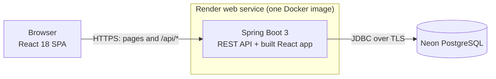
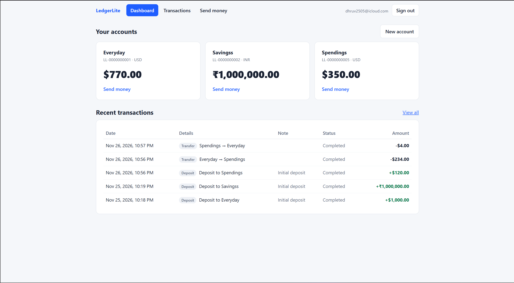
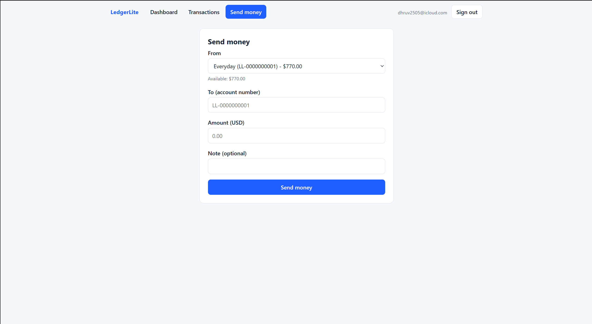
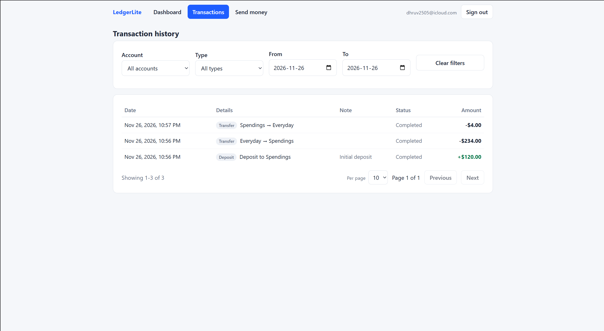

# LedgerLite

A small, secure payments platform built around a **double-entry ledger**: users hold accounts, move money between them
atomically, and can reverse mistakes without anything ever being edited or deleted.

[](https://github.com/Drv2709/ledgerlite/actions/workflows/ci.yml)

**Live demo:** https://ledgerlite-wg8w.onrender.com (a free instance sleeps when idle, so the first load can be slow).

## Features
- Register and sign in; sessions are a JWT in an **HttpOnly cookie** with CSRF protection
- Accounts in USD, CAD, EUR, GBP or INR; balances are **calculated from the ledger**, never stored
- Atomic transfers with overdraft protection and **idempotent retries** (`Idempotency-Key`)
- Reversals that post opposite entries instead of editing history
- Dashboard with balances and recent transactions; history with pagination and filters (account, type, date range)
- Loading, error and empty states on every screen
- Read-only admin API (users, all transactions) with two layers of authorization
- Users can only see their own accounts and transactions (IDOR protection, tested)

## Architecture
The deployed app is one Docker image: Spring Boot serves the API and the built React app from the same origin, with
PostgreSQL (Neon) behind it. More diagrams (cookie and CSRF flow, the transfer sequence, the data model) are in
[docs/architecture.md](docs/architecture.md).



## Tech stack
| Layer | Technology |
|---|---|
| Backend | Java 21, Spring Boot 3, Spring Security 6, Spring Data JPA, Flyway |
| Database | PostgreSQL 16 |
| Auth | JWT (jjwt) in an HttpOnly cookie, BCrypt, CSRF double-submit token |
| Frontend | React 18, Vite, TypeScript (strict, no `any`), TanStack Query, Axios, React Router |
| Tests | JUnit 5, Mockito, Testcontainers |
| CI/CD | GitHub Actions, Docker (multi-stage builds), Docker Compose |

## Design decisions
**No balance column.** An account's balance is `SUM(credits) - SUM(debits)` over immutable ledger entries. An
`UPDATE balance = balance + x` can lose updates under concurrency and destroys history; summing entries is auditable and is
how real ledgers work. Postgres enforces it: a trigger makes `ledger_entries` append-only, and a deferred trigger checks
that every transaction's debits equal its credits at commit.

**Money is never a float.** Java `BigDecimal` (scale 4, `HALF_EVEN`), `NUMERIC(19,4)` in Postgres, and decimal **strings** in
JSON. The frontend formats amounts with string math and compares them with `BigInt`.

**Concurrency: pessimistic locking.** A transfer locks both account rows with `SELECT ... FOR UPDATE` in ascending id
order (so opposite-direction transfers cannot deadlock) and reads the balance only after the lock is held. Optimistic
locking has nothing to version here, because the balance is derived, and it would turn contention into retry storms.
A JUnit test runs 10 threads against a $50 account: exactly 5 succeed and the balance ends at 0.

**Idempotency.** `POST /api/transfers` requires an `Idempotency-Key`. The first statement is
`INSERT ... ON CONFLICT DO NOTHING` on a unique `(user_id, key)`. A concurrent duplicate waits for the first request to
commit, then replays its stored response. The same key with a different payload returns 422. Failed requests are not cached.

**Reversals, not edits.** A reversal is a new transaction with opposite entries that points at the original. A unique
constraint allows one reversal per transaction.

**Why an HttpOnly cookie instead of localStorage.** Any script that runs on the page (an XSS bug, a compromised
dependency) can read `localStorage` and steal the token. It cannot read an HttpOnly cookie. Cookies are attached
automatically, which opens CSRF, so state-changing requests need a CSRF token that the browser's cross-site requests cannot
supply. The page and the API share one origin, so `SameSite=Lax` cookies work and no CORS is needed.

**Authorization.** Every account and transaction query is scoped to the authenticated user; another user's account is a
403. Admin endpoints are protected twice: by role in the filter chain, and by re-reading the role from the database on every
call, so a demoted admin loses access immediately. The admin API has no write endpoints, and the ledger stays immutable.

## API overview
Full contract with request and response examples: [docs/API_CONTRACT.md](docs/API_CONTRACT.md).

| Endpoint | Purpose |
|---|---|
| `POST /api/auth/register`, `/login`, `/logout`, `GET /api/auth/me` | Authentication |
| `GET/POST /api/accounts`, `GET /api/accounts/{id}` | Accounts and balances |
| `POST /api/transfers` | Atomic, idempotent transfer |
| `POST /api/transactions/{id}/reverse` | Reverse a transfer |
| `GET /api/transactions`, `GET /api/transactions/{id}` | History (pagination, filters) |
| `GET /api/admin/users`, `GET /api/admin/transactions` | Read-only admin API |
| `GET /health` | Liveness plus database check |

## Testing
- 50+ JUnit tests: unit tests (Mockito), integration tests against a **real PostgreSQL** (Testcontainers), a multi-threaded
  concurrency test, IDOR and admin authorization tests, static-site serving tests
- `scripts/test-transfers.sh`: 73 end-to-end checks against a running backend
- `scripts/smoke-test.sh`: 21 checks against a deployed or containerised stack
- Frontend: `npm run typecheck`, `npm run check:no-any` and a production build run in CI

```bash
./mvnw test        # needs Docker running
```
On a very new Docker engine, Testcontainers 1.19 may need `api.version=1.44` in `~/.docker-java.properties`.

## Run it locally
**Development** (hot reload):
```bash
docker compose up -d                 # PostgreSQL on :5455
./mvnw spring-boot:run               # API on :8080
cd frontend && npm install && npm run dev    # app on http://localhost:5173
```
**Whole stack in Docker:**
```bash
echo "JWT_SECRET=$(openssl rand -hex 32)" > .env
docker compose --profile full up -d --build --wait      # Nginx + API: http://localhost:8081
docker compose --profile single up -d --build --wait    # the single deployed image: http://localhost:8082
bash scripts/smoke-test.sh http://localhost:8082
```
**Demo data and an admin:**
```bash
bash scripts/seed-ui-demo.sh                          # demo users with 28 transactions
bash scripts/make-admin.sh demo...@example.com        # promote a user (sign in again afterwards)
```

## CI/CD
GitHub Actions runs on every push to `main` and every pull request: backend tests, frontend checks, and two Docker smoke
tests (the Nginx stack, and the single image that is deployed). See [.github/workflows/ci.yml](.github/workflows/ci.yml).
Deployment steps for Render and Neon: [docs/DEPLOY.md](docs/DEPLOY.md).

## Project structure
```
src/main/java/com/ledgerlite/   auth, account, ledger, transaction, transfer, idempotency, admin, config, common
src/main/resources/db/migration Flyway migrations (V1 schema and triggers, V2 accounts support)
src/test/java/                  unit, integration, concurrency and security tests
frontend/                       React app (Vite + TypeScript)
docs/                           ERD, API contract, architecture diagrams, deployment guide, plan and progress
scripts/                        smoke, end-to-end and demo-data scripts
Dockerfile, Dockerfile.render   API-only image, and the single image (API + React) that is deployed
```

## Limitations
This is a portfolio project, not a payment processor. There are no external payment rails, no email verification or password
reset, no rate limiting, and no admin screens in the UI. Accounts support five currencies and a transfer must stay within
one currency. Free hosting tiers sleep when idle.

## Screenshots








