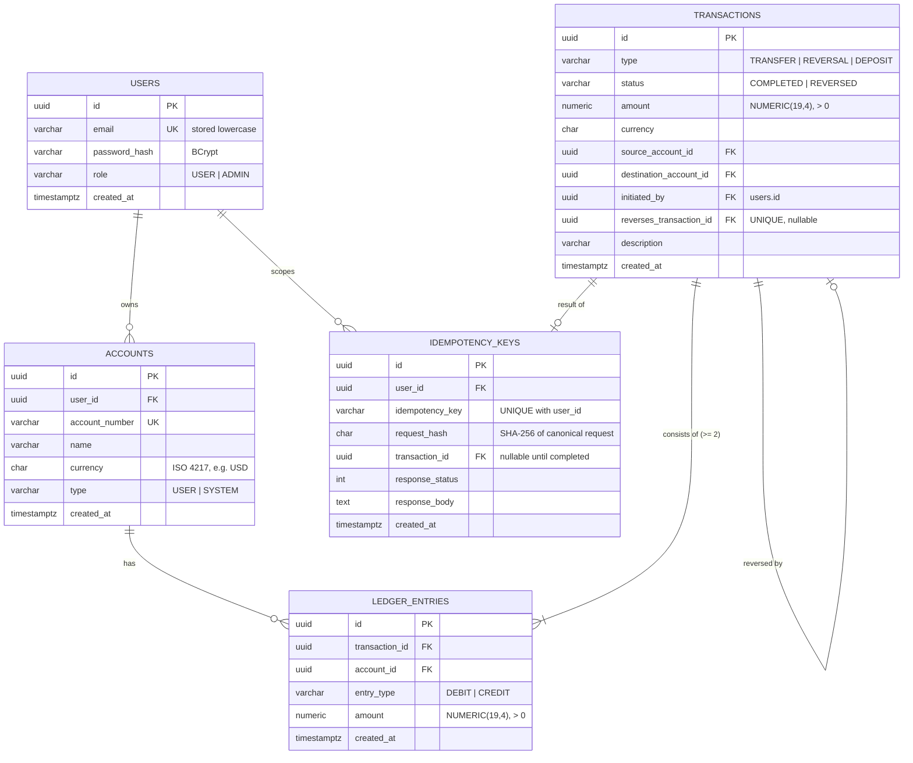

# LedgerLite: ERD and Design Decisions

## Entity Relationship Diagram



## 1. No balance column
`accounts` has **no balance column**. Balance is derived:

```
balance(account) = SUM(amount) WHERE entry_type = 'CREDIT'
                 - SUM(amount) WHERE entry_type = 'DEBIT'
```

`UPDATE accounts SET balance = balance + 100` is a read-modify-write that can lose updates under concurrency, and it destroys history. Summing immutable rows is auditable: any balance can be recomputed, and any past balance can be reconstructed with a `created_at` filter.

## 2. Double-entry rules
- Every transaction has at least one DEBIT and one CREDIT entry.
- For each transaction, `SUM(DEBIT) = SUM(CREDIT)`, so the signed sum is zero. A **deferred constraint trigger** checks this at commit.
- `amount` is always positive. Direction comes from `entry_type`.
- **Ledger entries are immutable.** A trigger rejects UPDATE and DELETE on `ledger_entries`.
- **Reversals:** a mistaken transfer is never edited or deleted. A new `REVERSAL` transaction posts opposite entries and points at the original through `reverses_transaction_id`. A UNIQUE constraint on that column means a transaction can be reversed at most once. The original's `status` flips to `REVERSED`; this is transaction metadata, not ledger data.
- The `SYSTEM` account (seeded) funds opening deposits. It is the only account allowed a negative balance. User accounts can never be overdrawn.

## 3. Money representation
- Java: `BigDecimal`, never `double` or `float`. Rounding is `RoundingMode.HALF_EVEN` at scale 4.
- Postgres: `NUMERIC(19,4)`. Exact decimal, no binary floating point.
- JSON: amounts are **strings** (`"10.00"`), so JavaScript never parses them into floating-point numbers.
- Single currency per account. A transfer between accounts of different currencies is rejected (`400`).

## 4. Idempotency strategy
- `POST /api/transfers` requires an `Idempotency-Key` header (client-generated UUID).
- Table `idempotency_keys` has `UNIQUE (user_id, idempotency_key)`.
- Flow, inside the transfer transaction:
  1. `INSERT` the key row with the request hash. If the unique constraint fires, another attempt already owns the key.
  2. Duplicate key with the same hash: return the **stored** response (status and body) and move no money.
  3. Duplicate key with a different hash: `422 Unprocessable Entity` (key reuse with a different payload).
  4. Success: store `transaction_id`, `response_status` and `response_body` on the key row in the same commit as the ledger entries.
- The database constraint is the authority, so two concurrent retries with the same key cannot both pass. One waits on the unique index and then sees the result.

## 5. Concurrency strategy: pessimistic locking
**Choice: `@Lock(LockModeType.PESSIMISTIC_WRITE)` (`SELECT ... FOR UPDATE`) on the account rows involved in a transfer.**

Why not optimistic (`@Version`)? Balances are derived from ledger rows, not stored on the account row, so there is no column for `@Version` to protect on the hot path. Optimistic locking would also need retry loops, and under contention (the 10-thread test) most attempts would fail and retry. Pessimistic locking serialises transfers per account, so the "check balance, then insert entries" sequence is atomic with respect to other transfers on that account.

Deadlock avoidance: accounts are always locked in **ascending UUID order**, so A to B and B to A cannot lock in opposite orders.

## 6. IDOR protection
- Every repository query that returns user data is scoped by the authenticated user's id (`findByIdAndUserId`), or the service verifies ownership.
- Accessing another user's account returns **403**.
- Transfers must have a **source account owned by the caller**. The destination may be any account (by account number), but responses never reveal its owner's details.

## 7. Indexes
- `ledger_entries(account_id, created_at)`: balance and history queries
- `ledger_entries(transaction_id)`: per-transaction integrity check
- `transactions(source_account_id, created_at)` and `transactions(destination_account_id, created_at)`: history filtering
- `accounts(user_id)`
