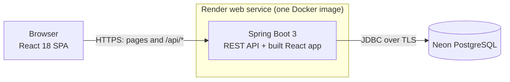
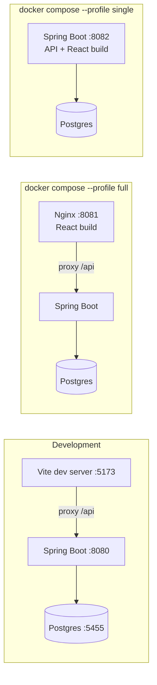
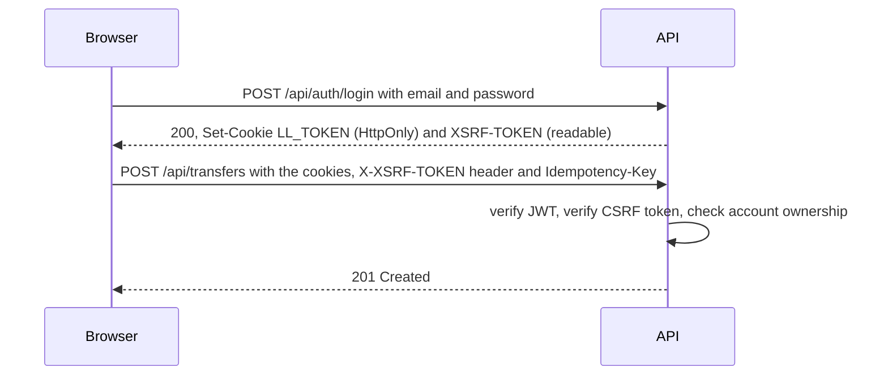
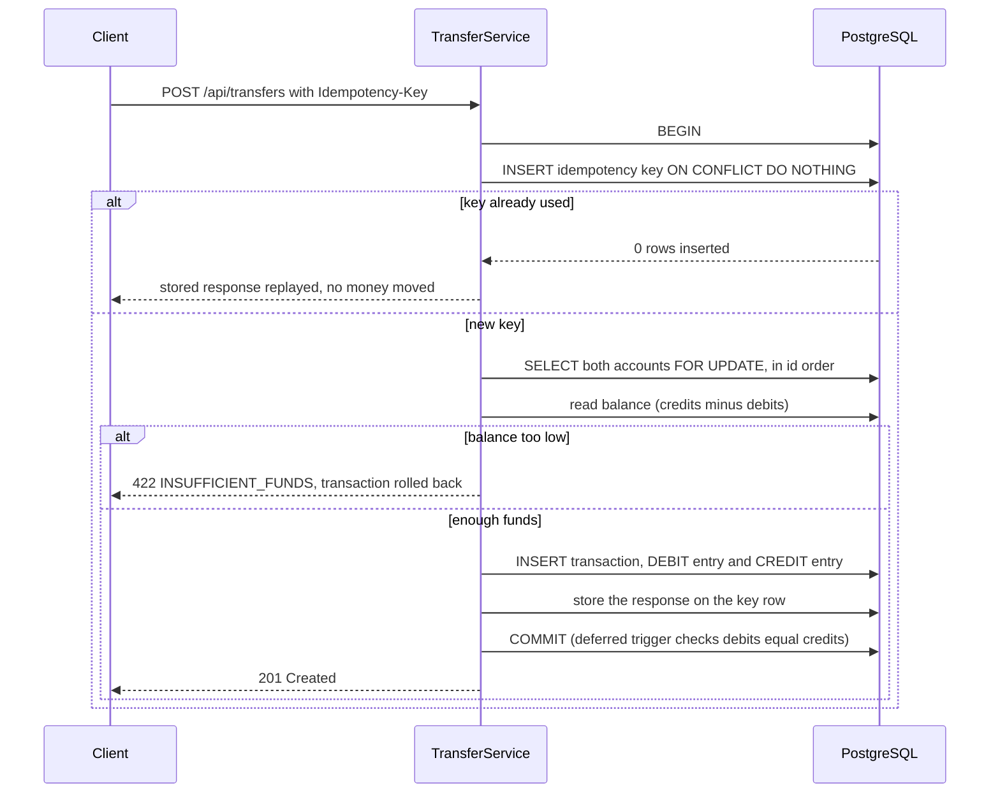
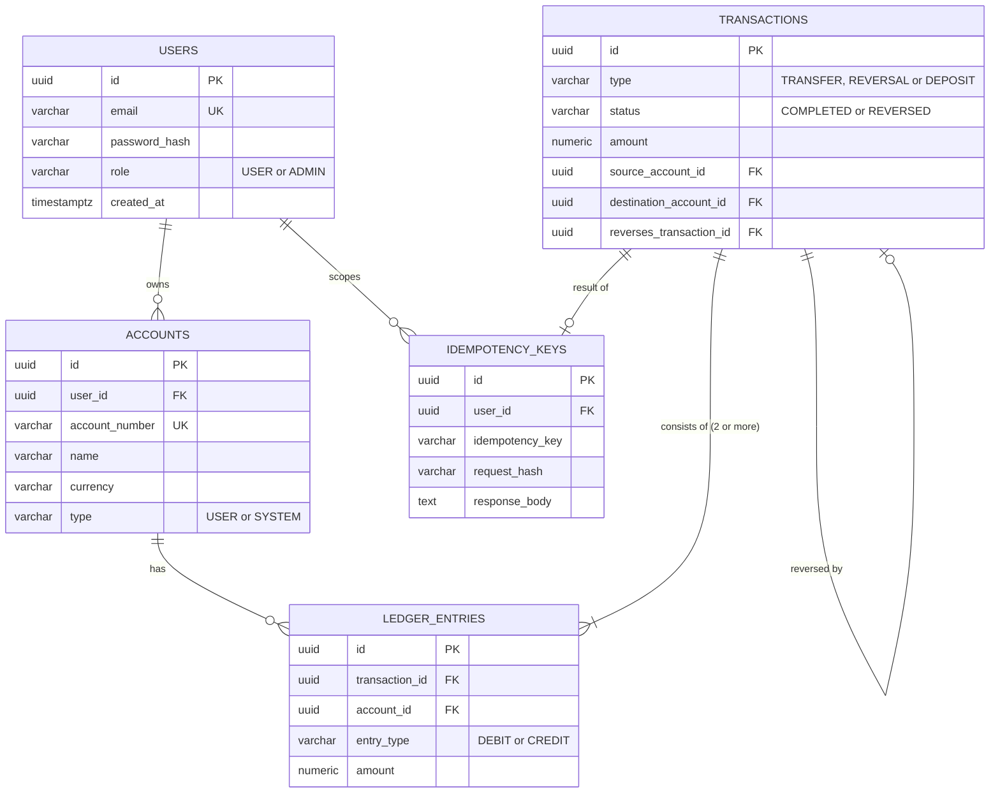

# LedgerLite: Architecture

## 1. Deployed system
One Docker image serves the React app and the API from the same origin, so the HttpOnly auth cookie never crosses sites
and no CORS configuration is needed. PostgreSQL is a managed Neon database.

## 2. The three local layouts

## 3. Authentication and CSRF
The JWT lives in an HttpOnly cookie, so JavaScript (and therefore any injected script) cannot read it. Because browsers
attach cookies automatically, state-changing requests also need the CSRF token, which the SPA reads from a second,
readable cookie and echoes in a header.

## 4. A transfer, step by step
Everything below happens in one database transaction.

## 5. Data model
No table has a balance column. A balance is always `SUM(credits) - SUM(debits)` over immutable ledger entries.

## 6. Database-enforced invariants
- `ledger_entries` is append-only: a trigger rejects UPDATE and DELETE.
- For every transaction, total DEBIT equals total CREDIT: a deferred constraint trigger checks it at commit.
- A transaction can be reversed once: a UNIQUE constraint on `reverses_transaction_id`.
- A key can be used once per user: a UNIQUE constraint on `(user_id, idempotency_key)`.
